# Procure to Pay Approval Portal

A working demo of an online approval portal for the full purchase journey, from the first internal office note to the payment advice sent to the vendor. It covers eight group companies, each with its own templates, approval chains and invoice fields, and it keeps an audit trail of everything that happens.

This document explains the product: who uses it, what problem each screen solves, why the rules are what they are, and where the demo stops and a real system would begin.

- **Live site:** https://p2p-portal-api.onrender.com (the same service serves the website and the API; free tier, sleeps after 15 minutes idle, so the first request can take about a minute)
- **Also on Vercel:** https://procure2-pay.vercel.app/ (the `frontend` folder, proxying the API to Render)
- **Demo mode:** a switch on the login page turns on one-click buttons for every role. Every demo password is `demo1234`. Switch it off to see only the login form.

## In short

This is a Procure to Pay approval portal built from the brief: ION, IOM, PR/PO, vendor invoice, SAP park and post details, and payment advice, with an audit trail throughout.

**Approach:** one generic approval engine that each company configures (who approves, in what order, above what amount), instead of hard-coding eight workflows.

**What works:** the full chain for all 8 companies, a vendor portal, GST and three-way match checks, separation of duties, and an append-only audit log.

**What is simulated or missing:** SAP is mocked and email is stored, not sent. Section 17 lists everything else I did not build, and why.

---

## How I approached it

**1. Reading the brief.** I started by listing the documents (ION, IOM, PR/PO, TRN, invoice) and who touches each one. Where the brief was vague, I wrote down an assumption instead of guessing silently. For example, I assumed approval levels depend on amount, and that the vendor should only ever see their own POs and invoices.

**2. One engine, not eight workflows.** The eight companies look different on paper but follow the same pattern: a chain of approvers, with extra levels above a value. I built one engine and made the chain, the approver and the amount limit editable per company. Adding a company is data, not code.

**3. Controls before polish.** An approval system is only useful if people cannot get around it. So I built the rules first: nobody approves their own request, one person cannot approve two steps of the same document, the person who raised a PO cannot pay its invoice, and changing an amount after approval sends it back through all approvals.

**4. Reviewing my own work.** After the first version I looked for logic errors and found three: edits after a query could skip the match re-check, one person could be placed on two levels of a chain, and the login lockout could be abused to lock other people out. I fixed the first two. I removed the lockout, because a lockout that anyone can trigger against someone else's account is a weakness, not a protection. The cost is that password guessing is not slowed, so I note it in section 17.

**5. Testing.** A single test script walks through the whole flow and the rule breaks, for example duplicate invoices, over-billing, and a vendor trying to see another vendor's data. I also looked at the real screens in a browser and fixed a styling bug that tests could not catch.

**6. Deliberate choices.** 
- SAP is mocked behind a clean seam, so a real integration replaces one place. Demo mode is a switch so reviewers can log in with one click, and it can be turned off. 
- Storage resets on Render's free tier, and persistent storage there is paid, so I kept the demo free and let it reseed itself on each start. This keeps a reviewer's first login always working with clean demo data. For lasting data, set `DATABASE_URL` to an external Postgres. Uploaded files would still need paid persistent disk or object storage.

---

## 1. The problem

Group companies approve purchases through email chains and spreadsheets. Three things go wrong again and again:

1. **Nobody can see where a request is stuck.** It is "with someone", but with whom, and for how long?
2. **Money leaves without a clean paper trail.** Was the vendor approved, was the PO issued, was the work actually done, was the invoice already paid once?
3. **Audit is painful.** Who approved what, when, and what did they see at that moment?

The portal gives every purchase one linked record, one approval path, and one log.

## 2. What the assignment asked for, and where it lives

| Requirement from the brief | How the portal covers it |
|---|---|
| Approvals profile after login, one profile per company: TUTPL, TRPL, UEPL, HEPL, DSEPL, DRL, PITCMRL, MRL | Eight companies, each user belongs to one. Admin and auditor see all with a company filter. |
| Templates inside each company: ION, IOM, TRN, SAP PR and PO, Invoice and Payment Status | One template per document type, per company, with extra fields a company can add. |
| ION for commercial and budget purposes, approaching vendors, circulating the RFP | ION template: department, justification, vendors to approach, budget. |
| IOM for vendor selection, comparison of quotes, justification of L1 | IOM template: quotes, selected vendor (L1), why. Must link to an approved ION. |
| TRN independent, to keep historical data | TRN stands alone, with an optional link to an IOM. |
| SAP PR and PO captured with PR number, PO number, creator and approver, date, day, time | Mock SAP raises the PR on submit and the PO after approval. The log shows names, date, day and time. |
| Invoice upload with PO or WO number, payment terms, percent payable, scope of work, completion | Invoice form has all of these. PO number is filled from the PO. WO number is not yet separate (see section 17). |
| Approval 1 to 5, query or rejection alerts the creator, creator fixes and sends it back to the same approver | Up to 6 levels. Query and reject return to the sender with a mail. Resubmit goes back to the approver who raised it. |
| Payment entry in SAP, service entry sheet or goods receipt to Accounts, park user and post user recorded | Requester enters the SES/GR number. Accounts records the park user, the post user is recorded automatically. |
| Payment released shows against the PO and invoice, payment advice emailed to the vendor | Payment shows on the invoice and PO chain. A payment advice mail goes to the vendor. |
| Audit compliant, activity logs, exportable | Append-only audit log with filters and CSV export, plus a read-only auditor role. |

## 3. Design principles

These decisions shaped almost every screen.

1. **One chain, one story.** ION, IOM, PR/PO and invoice are linked parent to child. Open any document and the whole chain is drawn at the top, with the current document highlighted. You never hunt for "the IOM behind this invoice".
2. **Show who is holding it.** Every pending document names the person it is waiting on and how many days. After 2 days it turns into a "Stuck" marker that appears in everyone's inbox and on the dashboard.
3. **Rules should refuse, not warn.** Over-billing, duplicate invoices, approving your own work and paying to unverified bank details are blocked, with a plain sentence saying why.
4. **Money before GST, everywhere.** PO values and invoice amounts are entered before GST so they compare like for like. GST is added only to compute what is payable.
5. **Different people for different duties.** The person who asks, approves, confirms the work, posts and pays are separated, on purpose (section 10).
6. **Vendors see status, not internals.** A vendor sees their POs and invoices and whether an invoice is "under review". They never see approver names, internal comments or history.
7. **Configuration over code.** Which approvers, in what order, from what amount, and which extra fields a company needs are settings an admin changes, not code.
8. **Honest about the demo.** SAP and email are simulated and labelled as such.

## 4. Who uses it

| Role | Login example | Does | Cannot |
|---|---|---|---|
| **Requester** (`creator`) | `creator.hepl` | Raises ION, IOM, TRN and the PR/PO request. Confirms work received on invoices for POs they raised. | Approve their own documents, raise invoices, post or pay. |
| **Business approver** (`approver`) | `approver1.hepl` | Approves ION, IOM, TRN. Does finance approval on invoices. Can delegate. | Approve documents they raised, or two steps of one document. |
| **Purchase team** (`purchase`) | `purchase1.hepl` | Approves PR/PO requests, with a second level by value. Can delegate. | Approve ION or IOM. |
| **Accounts** (`accounts`) | `accounts.hepl` | First check on invoices, records the SAP park and post details, releases payment, verifies vendor bank details. | Pay an invoice for a PO they raised. Pay while bank details are unverified. |
| **Vendor** (`vendor`) | `vendor.cooltech` | Sees POs addressed to them, submits invoices against approved POs, answers queries, manages bank details. | See other vendors, internal approvals, history, ION or IOM. |
| **Admin** | `admin` | Sets approval chains and extra fields per company, adds vendors, sees all companies. | Does not appear in approval chains by default. |
| **Auditor** | `auditor` | Reads everything across companies, including the audit log. | Change anything. |

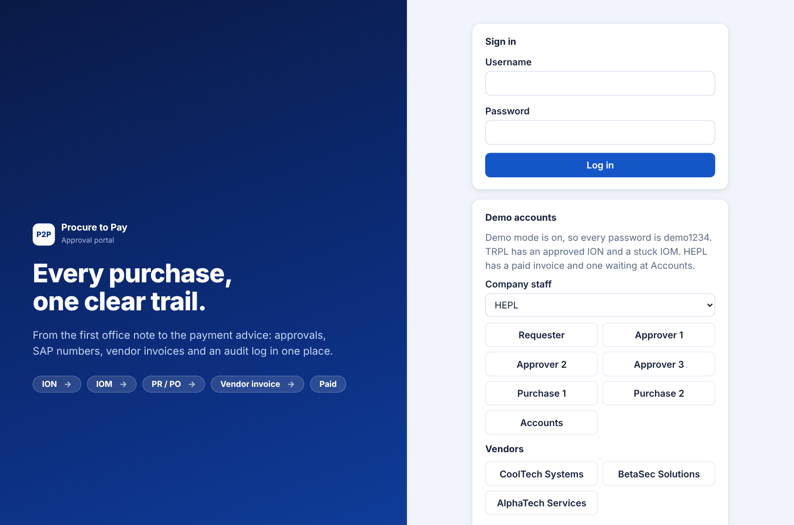

## 5. The purchase journey

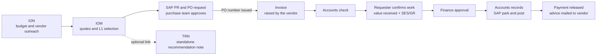

A document can only be created from an approved parent. You cannot raise an IOM without an approved ION, a PR/PO without an approved IOM, or an invoice without an approved PO addressed to that vendor.

### Document status

Every document is in one of six states.

| Status | Meaning |
|---|---|
| Draft | Being written by its creator, not yet in approval. |
| In approval | Waiting on the named approver. Locked for editing. |
| Query raised | An approver asked a question. Back with the creator, who edits and resubmits. |
| Rejected | An approver refused. Back with the creator, who may fix and resubmit. |
| Approved | Every required level has approved. |
| Paid | Invoices only. Payment released. |

## 6. The documents

| Document | Purpose | Created by | Core fields | Needs |
|---|---|---|---|---|
| **ION** Internal Office Note | Get budget and permission to approach vendors and circulate the RFP. | Requester | Department, purpose and justification, vendors to approach, budget | Nothing |
| **IOM** Inter-Office Memo | Choose the vendor: compare quotes and justify the L1. | Requester | Vendor quotes, selected vendor (L1), why this vendor, L1 amount | Approved ION |
| **TRN** Tender Recommendation Note | A standalone record of a tender recommendation, kept for history. | Requester | Tender reference, recommended vendor, recommendation, amount | Optional IOM link |
| **SAP PR and PO** | Ask to raise a purchase requisition and purchase order for a chosen vendor. | Requester | Items, delivery location and timeline, PO value (before GST), vendor | Approved IOM |
| **Invoice** | A vendor's bill against an approved PO. | Vendor | Invoice number and date, HSN/SAC, GST rate, IRN, payment terms, percent payable, scope of work done, completion status, attachments, plus company fields | Approved PO addressed to that vendor |

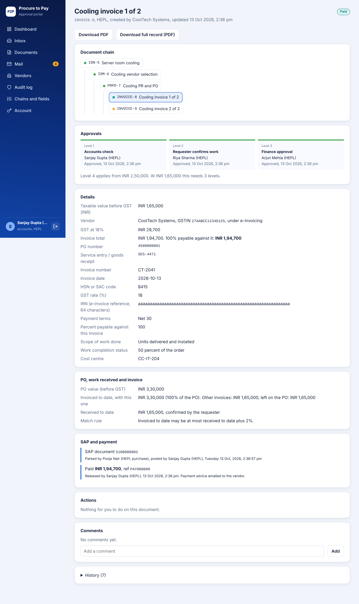

## 7. The approval engine

Approval is where most of the product thinking sits.

**Levels.** Every document type has an ordered chain of levels for each company. Each level names who approves and an optional amount from which it applies. Level 1 always applies.

Default chains seeded for every company:

| Document | Level 1 | Level 2 | Level 3 | Level 4 |
|---|---|---|---|---|
| ION, IOM | Approver 1 | Approver 2 (from INR 1,00,000) | | |
| TRN | Approver 1 | | | |
| PR and PO | Purchase team | Purchase head (from INR 1,00,000) | | |
| Invoice | Accounts check | Requester confirms work | Finance approval | Finance head (from INR 2,50,000) |

So a 50,000 ION needs one approver, a 1,50,000 one needs two. The document page says which levels were skipped and why.

**Snapshot on submit.** When a document is submitted, its chain is copied onto it. Changing the company settings later does not disturb documents already in flight.

**The query loop.** Any approver can approve, reject, or raise a query. Reject and query need a comment. The creator gets a mail and the document comes back to them. They edit, and resubmit. It then returns to the same approver who raised the query, not to the start. If the amount changed on an invoice, everyone starts again (section 8).

**Delegation.** An approver going on leave names a colleague with the same role. The delegate sees the approver's pending items and can act. The record says "by Name, as delegate". A delegate who approves level 1 cannot also approve level 2 of the same document.

**Stuck and reminders.** A pending item older than 2 days is marked Stuck for everyone in the company. The creator can send a reminder to the current approver, once an hour.

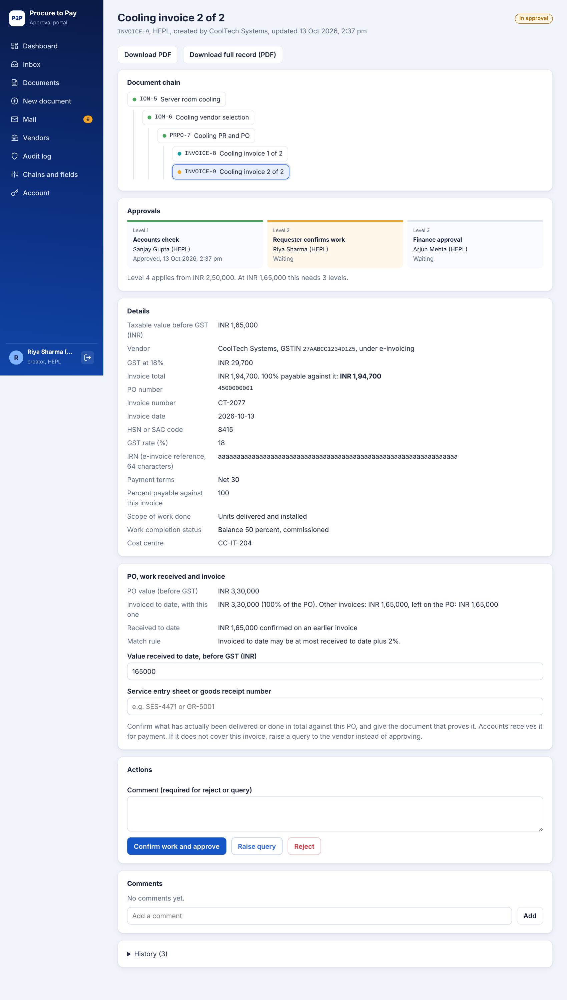

## 8. Invoices and the vendor portal

Invoices come from vendors, not from staff. That changes who can do what.

### What a vendor sees

A vendor logs in and sees only POs addressed to them (once approved) and their own invoices. They submit an invoice against a PO, see its status, answer a query and, later, see the payment advice. They can attach files and change their own bank details.

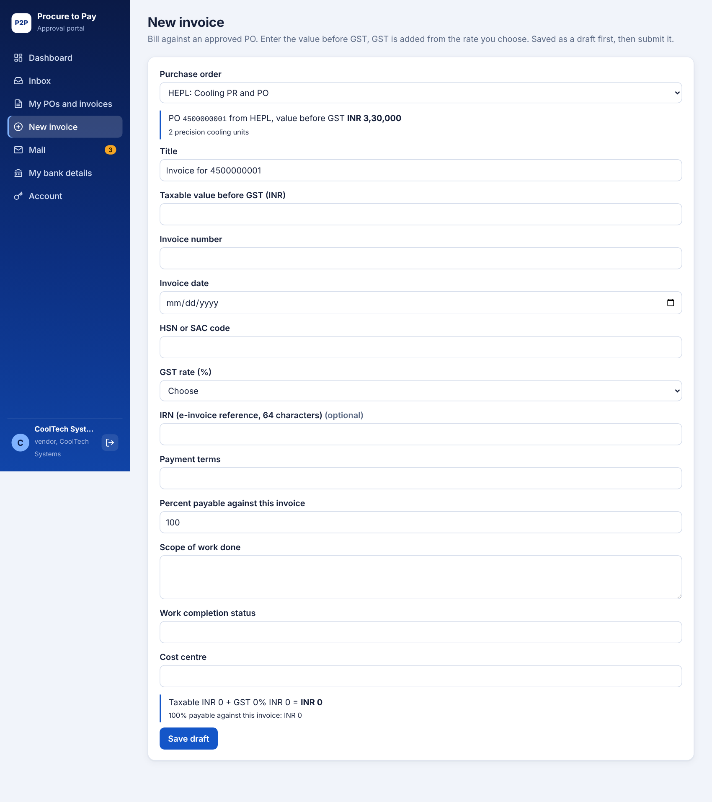

The form shows a live total as the vendor types: taxable value, GST at the chosen rate, invoice total and how much is payable now.

### Checks when the vendor submits

| Check | Rule |
|---|---|
| Company fields | Any extra field the company marked required must be filled. |
| GST rate | One of 0, 5, 12, 18, 28. |
| Invoice date | A real date, not in the future. |
| IRN | If provided, 64 hexadecimal characters. **Mandatory** if the vendor is flagged as under e-invoicing (turnover above INR 5 crore). |
| Duplicate invoice | The same invoice number from the same vendor is refused, ignoring case and spaces. |
| Over-billing | All invoices on one PO, counted from submission onward, may not add up to more than the PO value. |
| Vendor GSTIN | Must be in the standard 15 character format. The check digit is not verified. |

### The approval path for an invoice

1. **Accounts check.** Accounts reviews the invoice for completeness and tax details. They can query the vendor.
2. **Requester confirms work.** The person who raised the PO confirms what has actually been delivered. See the three-way match below.
3. **Finance approval.** Approver 1, then Approver 2 from INR 2,50,000.

Queries from any step go back to the **vendor**, who edits and resubmits to the same approver.

### Three-way match

The classic control is that the **PO**, the **goods or work received** and the **invoice** must agree. At step 2 the requester enters:

- **Value received to date**, before GST, in total against this PO.
- **Service entry sheet or goods receipt number**, the document that proves it, which Accounts needs.

The rule: invoiced to date, including this invoice, may be at most received to date plus a tolerance (2 percent by default, configurable). If it is not, approval is refused and the requester raises a query to the vendor instead. Received cannot exceed the PO value plus tolerance, and cannot go lower than what was confirmed on an earlier invoice.

### If the amount changes

If a vendor changes the invoice amount after some approvals, every approval, including the work confirmation, starts again from level 1. An approval given for one amount should not carry over to another. Other edits go back to the same approver.

### Payment amount

Payment is `(taxable value + GST) x percent payable`. Percent payable lets a vendor bill 100 percent of a stage while only some is due now.

### Bank details

A vendor can change their bank details, but nothing is paid to them until Accounts verifies the change. While a change is pending, or if the bank was never verified, the Release payment button does not appear and the page says why.

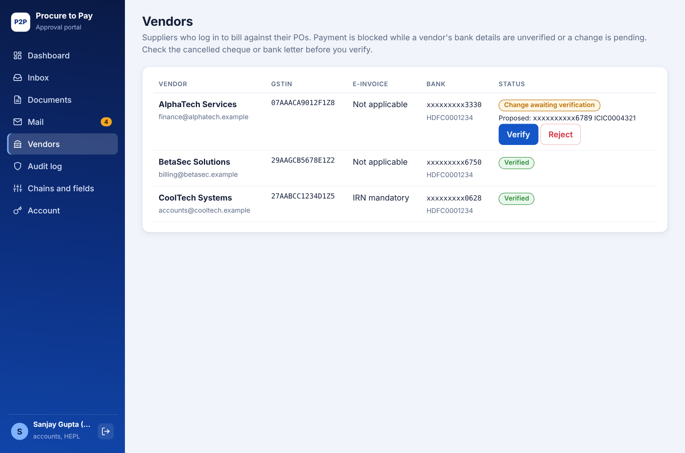

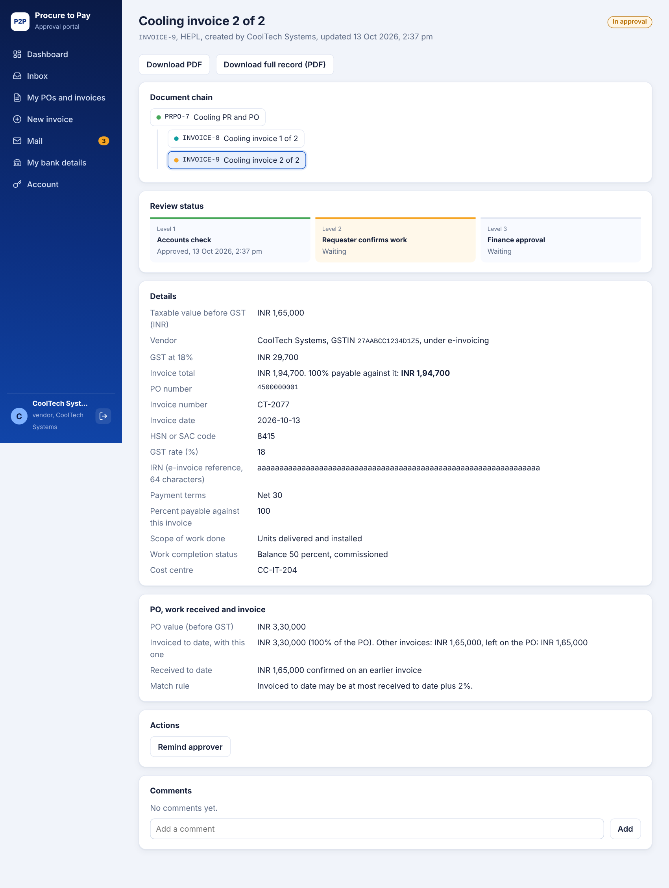

## 9. SAP integration (simulated)

The brief asks the portal to capture SAP details. In this demo SAP is mocked on the server so the full flow can be shown without a SAP system.

| Moment | What the portal records |
|---|---|
| PR and PO request submitted | A **PR number** is generated at once. |
| PR and PO request approved by the purchase team | A **PO number** is issued. The vendor is mailed. |
| Invoice fully approved | Accounts is mailed that it is ready to post. |
| Accounts records the SAP entry | **Park user** (typed by Accounts, an internal person, never the vendor), **post user** (the logged-in Accounts user), SAP document number, date, **day** and time. |
| Payment released | Payment reference and amount against the PO and invoice. |

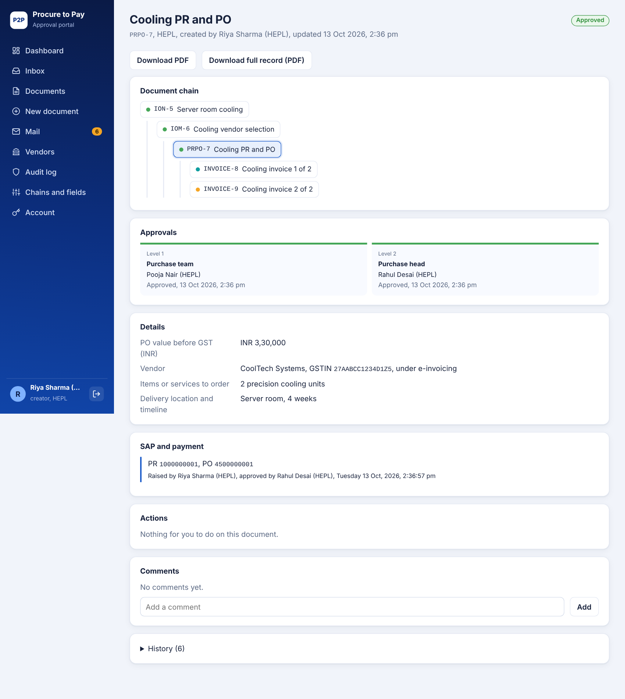

**What real integration would involve.** Replace the number generators in `service.py` with calls to SAP (typically OData or BAPI via a gateway) for PR creation, PO release, invoice park and post, and payment status. The portal's data model already stores the same fields, so only the source of the numbers changes.

## 10. Controls: who may do what

These rules are enforced by the server, not just hidden in the interface.

| Control | Rule |
|---|---|
| No self approval | Nobody approves a document they raised. |
| One person, one step | Nobody approves two steps of the same document, including through delegation. |
| Chain sanity | The admin cannot put the same person on two levels of one chain, since the document could then never finish. |
| PO raiser cannot pay | Whoever raised the PO cannot post or pay its invoice. |
| Only the vendor raises invoices | Staff cannot create invoices. A vendor can only bill their own POs. |
| Bank verification | Payment is blocked until the vendor's bank details are verified. |
| Read only auditor | The auditor can see everything and change nothing. |
| Data separation | Staff see only their own company. Vendors see only their own documents. A request for something you cannot see answers "not found", so ids cannot be probed. |

## 11. Audit and compliance

Everything meaningful writes a line to the audit log: logins and failed logins, creating, editing, submitting, every approval decision, comments, SAP entries, payments, downloads, config changes and exports.

- **Append only.** In the database, updates and deletes on the log are refused by triggers. This is tested on SQLite. Equivalent Postgres and MySQL triggers are written but not tested.
- **Filters.** By date range, action, role, user, document, text in the detail and, for admin and auditor, company.
- **Export.** The CSV export follows the filters and is itself logged. Cells starting with `=`, `+`, `-` or `@` are escaped so spreadsheets do not run them as formulas.
- **PDF records.** Any document can be downloaded as a PDF, or the whole chain as one purchase record, listing details, approvals with names and times, SAP data, payment and comments.

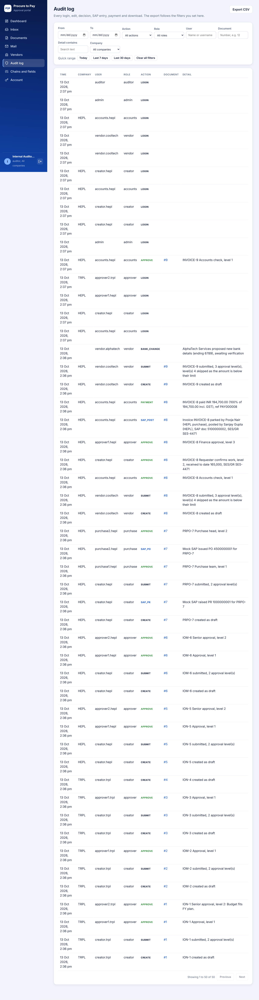

## 12. A tour of the screens

**Dashboard** is the landing page. Tiles count documents by state (click one to open the list), donuts show approval health and the status mix, bars show documents by type and by company, and panels show money (committed, invoiced, paid), where approvals are waiting and average time to approve. Filters: document type, period (month, quarter, year, all time, custom) and, for admin and auditor, company.

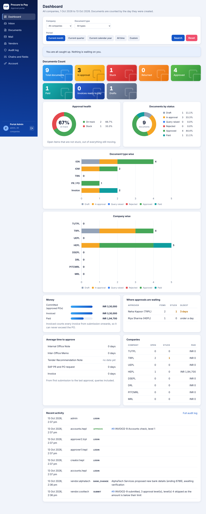

**Inbox** is the work queue: items waiting for your approval, items returned to you, approved IOMs ready for a PR/PO request, approved invoices for Accounts to post and pay, and everything stuck in your company.

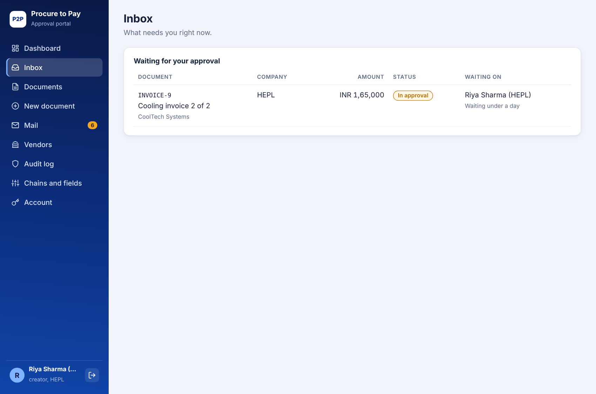

**Documents** lists everything you can see, with filters for type, status, text and stuck only.

**Document page** shows, top to bottom: the chain, the approvals (who, what they decided and when), the details, the PO and work received panel (invoices), SAP and payment, the actions available to you, comments and history.

**Mail** is the simulated email inbox. New mail is highlighted and counted in the menu. Every alert in the process lands here, so you can see exactly who is told what.

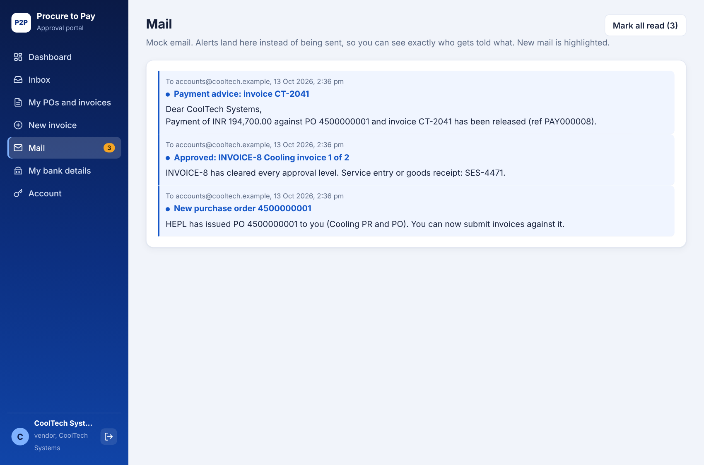

**Vendors** (staff) lists suppliers, their GSTIN, whether e-invoicing applies and bank status. **My bank details** (vendor) is where a vendor proposes new details.

**Chains and fields** (admin) edits who approves each document type for a company, level by level, with the amount thresholds, and adds extra fields.

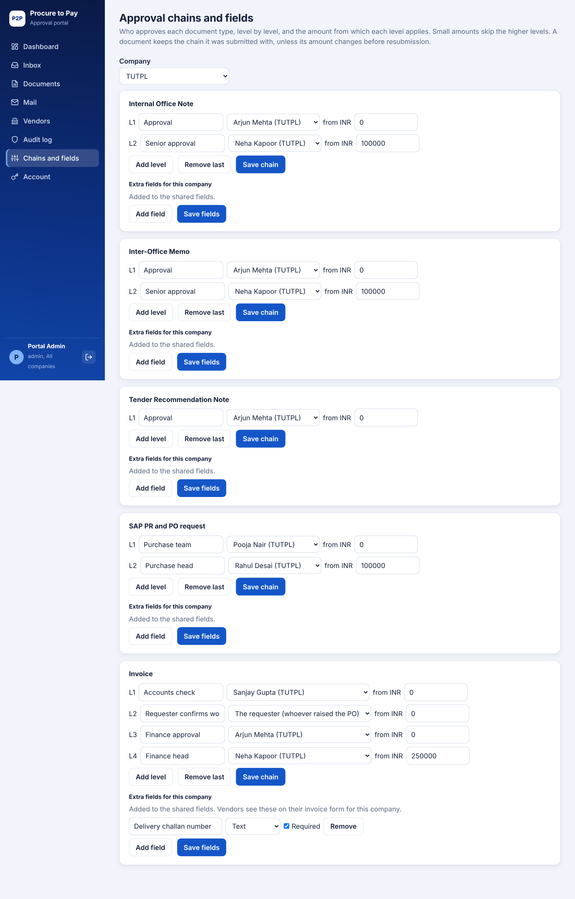

**Delegation** lets approvers hand their items to a colleague. **Account** changes your password.

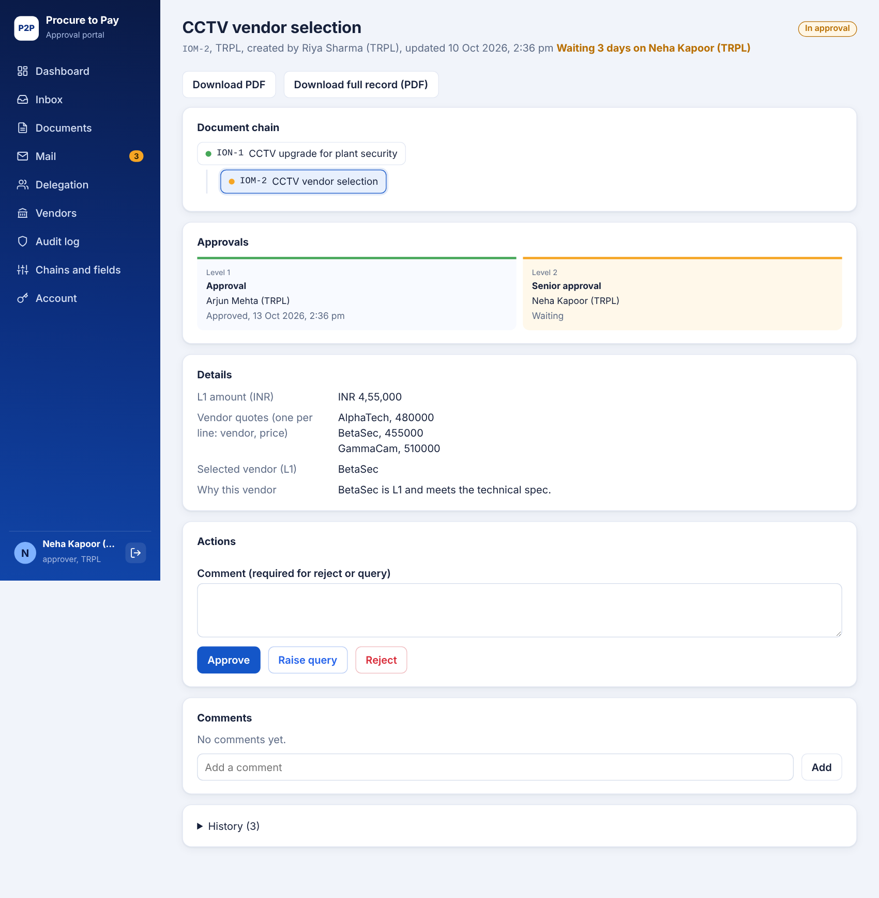

## 13. Making it fit each company

Companies differ. The portal keeps what is common and lets each company adapt the rest:

- **Shared core fields** are identical across companies, so reports compare like with like.
- **Extra fields** can be added per company and document type by the admin: text, number, date or long text, required or optional. Vendors see their company's extra invoice fields on the form. Examples seeded: Delivery challan number (TUTPL), Project code (UEPL), Cost centre (HEPL), Contract reference (DSEPL), Batch or lot number (DRL), Work order number (PITCMRL), Plant code (MRL).
- **Approval chains** are separate for each company and document type.

## 14. Notifications

Notifications are stored as mock emails. They are sent when:

- a document needs your approval, or an earlier level cleared it;
- a document is approved, queried or rejected;
- you are reminded about something pending;
- a PO is issued (to the vendor);
- an invoice is fully approved (to Accounts);
- payment is released: the requester is told, and the vendor gets a payment advice;
- a vendor changes bank details (to Accounts), and when Accounts verifies or rejects them;
- you are named as someone's delegate.

## 15. Under the hood

| Part | Choice |
|---|---|
| Backend | FastAPI (Python), SQLAlchemy 2 |
| Database | SQLite by default. Set `DATABASE_URL` for Postgres or MySQL. |
| Frontend | One HTML file with plain JavaScript, no build step, no chart library (charts are drawn as SVG) |
| PDFs | reportlab |
| Passwords | bcrypt |
| Sessions | Random tokens, only a hash is stored. 12 hours absolute, 4 hours idle, several devices allowed, logout and password change end sessions. |
| Uploads | Allowed types: pdf, png, jpg, xlsx, xls, csv, docx. Checked by extension and by the file's first bytes. Size limit (5 MB, 4 MB on Render). At most 10 per document. Always downloaded, never displayed inline. |
| Headers | `nosniff`, no framing, no caching of API responses |

**Data model.** `company`, `app_user`, `vendor`, `document` (one table for all five types, linked by `parent_id`, with a JSON `data` column for type specific fields), `approval_config` and `approval_step` (the chain and its per document snapshot), `field_config` (company extra fields), `delegation`, `comment`, `sap_record`, `payment`, `audit_log`, `notification`, `user_session`.

**Why one document table.** Every type shares status, amount, owner, parent and approval steps. Only the form fields differ, so they live in JSON and in templates. Adding a new document type is a template, a chain and a label, not a new set of tables.

## 16. Running and deploying

### Run on your computer

```
pip install -r requirements.txt
cd backend
uvicorn app:app --reload
```

Open http://127.0.0.1:8000. First start creates `p2p.db` and loads demo data. Delete `backend/p2p.db` to reset.

Run the tests with `cd backend && python test_flow.py`. A GitHub Action runs them on every push.

### Deploy

1. **Render, the API.** New, Blueprint, pick the repo (it reads `render.yaml`). Check `/api/health`.
2. **Vercel, the website.** `vercel.json` serves the `frontend` folder and forwards `/api` to the Render address, so the browser only talks to one origin and no CORS setup is needed.

**Free tier cautions.**
- Render free sleeps after 15 minutes. Open the health link before a demo.
- Free instances have no disk, so data and uploads reset on restart and the app reloads the demo data. For data that survives, add a Render Postgres and set `DATABASE_URL`.
- Keep uploads small. Vercel's limit on proxied request sizes was not verified.
- For anything real, set `DEMO_MODE=0` to hide quick-login buttons and the API docs, and change all passwords.

### Settings

| Variable | Default | Meaning |
|---|---|---|
| `DATABASE_URL` | SQLite file | Postgres or MySQL connection |
| `DEMO_MODE` | 1 | Shows demo logins and API docs |
| `MAX_UPLOAD_MB` | 5 | Largest attachment |
| `BCRYPT_ROUNDS` | 10 | Password hashing cost |
| `SESSION_HOURS` / `IDLE_HOURS` | 12 / 4 | Session lifetime and idle timeout |
| `STUCK_DAYS` | 2 | Days before an item is flagged Stuck |
| `MATCH_TOLERANCE_PCT` | 2 | Three-way match tolerance |

## 17. Limits, assumptions and what comes next

**Simulated, not real**
- SAP numbers and entries are generated by the demo. Email is stored, not sent.

**Not built yet**
- A company-tile landing screen as drawn in the brief. Today the menu is the same for every company and the dashboard has a company filter for admin and auditor.
- A separate **WO number** on the invoice. Only the PO number is captured.
- TDS deduction and the IGST versus CGST/SGST split. GST is a single rate.
- The GSTIN check digit.
- Real email, single sign-on, an approvals mobile view.

**Known soft spots**
- There is no login lockout. Wrong passwords are logged, but guessing is not slowed. Turn off demo mode before sharing the site widely.
- Audit log protection is tested on SQLite only.
- Percent payable pays only part of an invoice, and the unpaid remainder is not tracked afterwards, as the brief describes it.
- The Vercel to Render path for file uploads is untested at the size limit.

**Decisions worth confirming with the business**
- Should invoice approval order be Accounts, requester, finance as seeded, or requester first?
- Are the amount thresholds (INR 1,00,000 and 2,50,000) right for each company?
- Should a rejected invoice free its amount on the PO immediately (it does today) or after review?
- Is 2 percent the right three-way match tolerance?

## 18. Try it in five minutes

1. **vendor.cooltech**: open the dashboard, then My POs and invoices, and the pending invoice. Note the review status and no internal names.
2. **accounts.hepl**: Inbox, open the invoice, approve the Accounts check.
3. **creator.hepl**: open the same invoice. Enter value received 3,30,000 and an SES number, confirm and approve.
4. **approver1.hepl**: approve the finance step.
5. **accounts.hepl**: type a SAP park user, record the entry, release payment. The vendor's Mail now has a payment advice.
6. **Try to break it** as vendor.cooltech: submit the same invoice number twice, submit more than the PO value, or approve your own document.
7. **accounts.hepl**, Vendors: AlphaTech proposed new bank details. Verify them.
8. **admin**: Chains and fields. Add an extra invoice field for a company, then view the vendor form for that company.
9. **auditor**: read through the audit log, filter by action, export CSV.

## 19. Repository layout

```
backend/
  app.py        routes, sessions, uploads, audit export
  service.py    all business rules (approval engine, checks, payment, dashboard)
  models.py     database tables and audit log protection
  security.py   password hashing and session tokens
  seed.py       demo companies, users, vendors, chains and example documents
  pdfgen.py     PDF records
  test_flow.py  end to end test of the whole process
frontend/index.html   the whole interface
docs/screens/         screenshots used in this document
render.yaml  vercel.json  requirements.txt  .env.example
.github/workflows/test.yml
```
